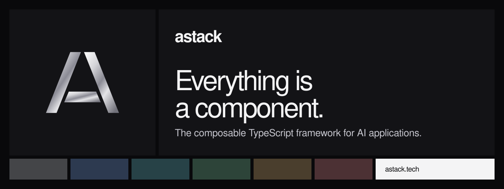

<a href="https://astack.tech"></a>

[Website](https://astack.tech) · [Docs](https://astack.tech/docs) · [Examples](https://astack.tech/examples) · [Source](https://github.com/astack-tech/astack) · [npm](https://www.npmjs.com/org/astack-tech) · [Brand](https://astack.tech/brand)

AStack is an open-source TypeScript framework for AI agents, workflows and retrieval. Its central idea is **everything is a component**: models, tools, agents and application logic share one component interface. You connect their ports into a pipeline, and data flows along the connections.

## The computation model

Three ideas carry the whole framework: **components** with named ports, **ports** that connect outputs to inputs, and **pipelines** that run the graph. Agents, multi-step workflows and routing are patterns built from them, not separate subsystems. The runtime is [HLang](https://github.com/hlang-tech/hlang), a flow-based programming runtime on RxJS, so each connection is an observable stream.

The model is original. [PocketFlow](https://the-pocket.github.io/PocketFlow/) reached a similar "the graph is the framework" idea independently and focuses on a 100-line Python core. AStack does not optimize for line count: it optimizes for typed, reactive data flow in TypeScript, where each connection carries its own data instead of a shared store. [Read the comparison](https://astack.tech/docs/introduction).

| Package | Purpose |
| --- | --- |
| [`@astack-tech/core`](https://www.npmjs.com/package/@astack-tech/core) | `Component`, `Pipeline` and ports |
| [`@astack-tech/components`](https://www.npmjs.com/package/@astack-tech/components) | Agents, streaming, RLM, text splitting and tool invocation |
| [`@astack-tech/tools`](https://www.npmjs.com/package/@astack-tech/tools) | Tools that agents can call |
| [`@astack-tech/integrations`](https://www.npmjs.com/package/@astack-tech/integrations) | Model providers |

## Start building

```sh
npm install @astack-tech/core@beta @astack-tech/components@beta
```

Follow [Getting started](https://astack.tech/docs/getting-started), then work through the [examples](https://astack.tech/examples) in order. Each one is a single file that adds one idea: component, pipeline, routing, tools, chat, workflow, agent, streaming, RLM and an HTTP server. AStack is in public beta; check the [changelogs](https://github.com/astack-tech/astack/releases) before you update.

## Contribute

AStack is [MIT licensed](https://github.com/astack-tech/astack/blob/master/LICENSE). Read the [contribution guide](https://github.com/astack-tech/astack/blob/master/.github/CONTRIBUTING.md) and [AGENTS.md](https://github.com/astack-tech/astack/blob/master/AGENTS.md), then open a pull request against `dev`. Every change starts with a failing test.

[Report an issue](https://github.com/astack-tech/astack/issues) · [Discussions](https://github.com/astack-tech/astack/discussions) · [Security](https://github.com/astack-tech/astack/security/policy)
